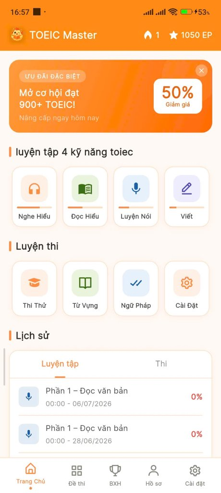
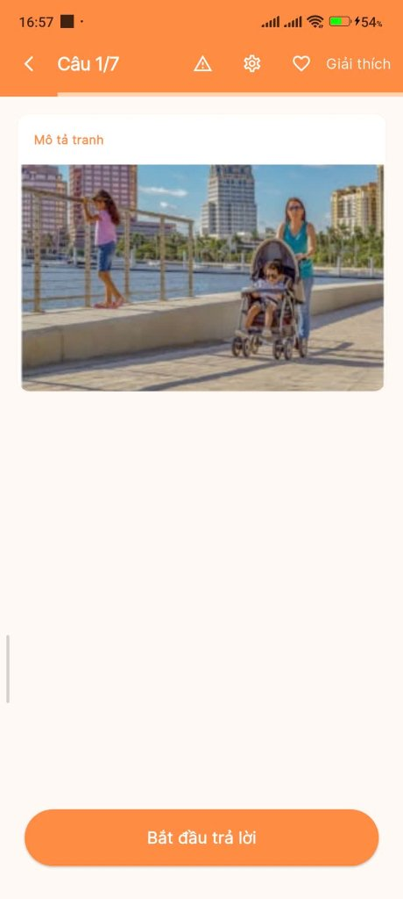
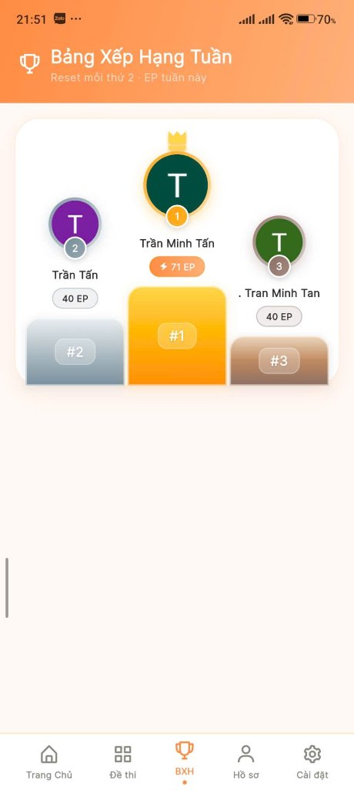

# 📱 TOEIC Learning Platform — Mobile App (Flutter)

[](https://flutter.dev)
[](https://dart.dev)
[](https://firebase.google.com)
[](LICENSE)

> Ứng dụng di động luyện thi TOEIC 4 kỹ năng toàn diện, tích hợp trí tuệ nhân tạo (AI) chấm điểm bài thi Nói (Speaking) và Viết (Writing), áp dụng thuật toán lặp lại ngắt quãng (Spaced Repetition System - SRS) giúp ghi nhớ từ vựng hiệu quả cùng hệ thống thi đua Gamification thời gian thực.

---

## 🌐 Hệ Sinh Thái Dự Án (Ecosystem Repositories)

Hệ thống được phát triển theo mô hình Client-Server hiện đại, bao gồm 3 thành phần chính:

* 🚀 **Backend API (.NET 9):** [https://github.com/TranMinhTan3110/toeic-backend-api](https://github.com/TranMinhTan3110/toeic-backend-api)  
  *Core RESTful API, Clean Architecture, Firestore NoSQL, Hybrid AI Engine (Gemini & OpenAI), Docker, AWS EC2.*
* 📱 **Mobile Client (Flutter):** [https://github.com/TranMinhTan3110/toeic-mobile-app](https://github.com/TranMinhTan3110/toeic-mobile-app) *(Repo này)*  
  *Ứng dụng di động đa nền tảng (Android & iOS) phục vụ người học.*
* 💻 **Web Admin Portal (ReactJS):** [https://github.com/TranMinhTan3110/toeic-web-app](https://github.com/TranMinhTan3110/toeic-web-app)  
  *Trang quản trị cho giáo viên/admin quản lý ngân hàng câu hỏi, tạo đề thi và phân quyền.*

---

## 📸 Giao Diện Ứng Dụng (App Screenshots)

<div align="center">
  <table style="border: none;">
    <tr>
      <td align="center"><br/><b>Trang chủ & Lộ trình</b></td>
      <td align="center"><br/><b>Luyện thi Listening/Reading</b></td>
      <td align="center"><br/><b>Chấm điểm Nói bằng AI</b></td>
      <td align="center"><br/><b>BXH & Điểm thưởng EP</b></td>
    </tr>
  </table>
</div>

> *Tip: Đặt ảnh chụp màn hình thực tế của ứng dụng vào thư mục `docs/screenshots/` theo đúng tên trên để ảnh tự động hiển thị lung linh trên GitHub!*

---

## ✨ Tính Năng Nổi Bật (Key Features)

### 1. 🎧 Luyện Thi 4 Kỹ Năng (TOEIC 4 Skills)
* **Listening & Reading (Part 1 - 7):** Làm bài thi thử nghiệm hoặc luyện từng phần với giao diện phát audio và hình ảnh chuẩn format ETS.
* **Speaking AI:** Học viên thu âm trực tiếp bài nói; âm thanh được gửi về Backend xử lý đa phương thức (Multimodal Audio AI) qua Google Gemini để chấm phát âm, ngữ điệu, ngữ pháp và nhận xét chi tiết.
* **Writing AI:** Viết câu miêu tả tranh, viết email phản hồi và bài luận ngắn; AI tự động sửa lỗi diễn đạt, từ vựng và chấm điểm theo tiêu chí TOEIC.

### 2. 🧠 Học Từ Vựng Với Thuật Toán SRS (Spaced Repetition System)
* Học từ vựng theo dạng Flashcard tương tác (lật thẻ, nghe phát âm giọng bản xứ bằng TTS).
* Tự động tính toán chu kỳ lặp lại ngắt quãng (1 ngày, 3 ngày, 7 ngày...) dựa trên mức độ thuộc của học viên, giúp ghi nhớ lâu dài mà không bị quá tải.

### 3. 🏆 Gamification & Thi Đua (Leaderboard)
* Tích lũy **Engagement Points (EP)** sau mỗi bài học và bài thi.
* Theo dõi chuỗi ngày học liên tục (**Streak**) và nhận thông báo nhắc học hàng ngày qua Local Notifications.
* Bảng xếp hạng (Leaderboard) thời gian thực cạnh tranh điểm số giữa các học viên.

### 4. 📊 Lịch Sử Làm Bài & Phân Tích Điểm Số
* Lưu trữ toàn bộ lịch sử thi, xem lại đáp án chi tiết và giải thích từng câu hỏi.
* Biểu đồ theo dõi tiến bộ điểm số Listening & Reading theo thời gian.

---

## 🛠️ Công Nghệ Sử Dụng (Tech Stack)

* **Ngôn ngữ & Framework:** [Flutter](https://flutter.dev) (SDK 3.11+), [Dart](https://dart.dev).
* **Quản lý trạng thái (State Management):** `Provider`.
* **Kết nối mạng & API Client:** `Dio` (xử lý interceptor, cache token, timeout handling).
* **Âm thanh & Giọng nói:** 
  * `record`: Thu âm bài thi Nói với chất lượng tối ưu.
  * `audioplayers`: Phát file audio bài nghe TOEIC.
  * `flutter_tts`: Đọc phát âm từ vựng (Text-To-Speech).
* **Xác thực người dùng:** `firebase_auth`, `google_sign_in` (Đăng nhập Google hoặc Email/OTP).
* **Hiệu ứng & UI:** `flutter_card_swiper`, `flip_card`, `lucide_icons`, `remixicon`, `google_fonts`.
* **Thông báo:** `flutter_local_notifications`, `timezone` (nhắc nhở học hàng ngày duy trì Streak).
* **Lưu trữ cục bộ:** `shared_preferences` (lưu token, cấu hình offline).

---

## 📁 Cấu Trúc Thư Mục (Project Architecture)

```
lib/
├── core/                  # Các thành phần dùng chung hệ thống
│   ├── constants/         # API Endpoints, app strings, colors
│   ├── theme/             # Theme sáng/tối, Typography
│   └── utils/             # Helper xử lý Audio, validator, date format
├── data/                  # Tầng dữ liệu (Data Layer)
│   ├── models/            # Data Models (User, Question, ExamResult, EP)
│   ├── repositories/      # Gọi API và chuyển đổi dữ liệu
│   └── services/          # HTTP Client (Dio), Firebase Service
├── providers/             # Quản lý State (Provider State Management)
│   ├── auth_provider.dart # Trạng thái đăng nhập & phân quyền
│   ├── exam_provider.dart # Tiến trình làm bài thi và nộp bài
│   └── user_provider.dart # Profile, điểm EP, Streak
├── ui/                    # Tầng giao diện người dùng (Presentation Layer)
│   ├── screens/           # Các màn hình chính (Auth, Home, Exam, Vocabulary...)
│   └── widgets/           # Các widget tái sử dụng (Custom Button, Card, Dialog...)
└── main.dart              # Entry point của ứng dụng
```

---

## 🚀 Hướng Dẫn Cài Đặt & Chạy Dưới Local (Getting Started)

### 1. Yêu Cầu Môi Trường
* Đã cài đặt **Flutter SDK** (v3.11 trở lên) & **Dart**.
* Đã cài **Android Studio** hoặc **VS Code** kèm Flutter/Dart extension.
* Thiết bị thật hoặc máy ảo (Android Emulator / iOS Simulator).

### 2. Clone Dự Án
```bash
git clone https://github.com/TranMinhTan3110/toeic-mobile-app.git
cd toeic-mobile-app
```

### 3. Cài Đặt Thư Viện
```bash
flutter pub get
```

### 4. Cấu Hình Môi Trường (.env)
Tạo hoặc kiểm tra file `.env` tại thư mục gốc của project:

```env
# Khi test trên Máy ảo Android (Android Emulator gọi vào Backend máy tính):
API_BASE_URL=http://10.0.2.2:8080/api
API_BASE_URL_ANDROID=http://10.0.2.2:8080/api

# Khi test trên iOS Simulator hoặc Web:
API_BASE_URL_IOS=http://localhost:8080/api
API_BASE_URL_WEB=http://localhost:8080/api

# Khi test trên Thiết bị thật (Dùng chung Wi-Fi, thay bằng IP máy tính của bạn):
# API_BASE_URL_ANDROID=http://192.168.1.x:8080/api
```

### 5. Khởi Chạy Ứng Dụng
```bash
# Đảm bảo Backend API (.NET) đang chạy tại port 8080
flutter run
```

---

## 👥 Thành Viên Phát Triển (Team)

Dự án được xây dựng bởi nhóm 5 thành viên:
* **Trần Minh Tấn (Leader & Core Backend):** Thiết kế kiến trúc tổng thể, xây dựng Backend API .NET 9, tích hợp AI chấm thi, điều phối nhóm và triển khai Cloud.
* **Nhóm phát triển Mobile & Web:** Cùng xây dựng giao diện người dùng, tích hợp gọi API và kiểm thử tính năng.

---

## 📄 License
Phát hành theo giấy phép [MIT License](LICENSE).
